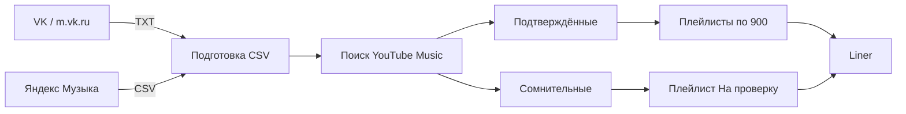
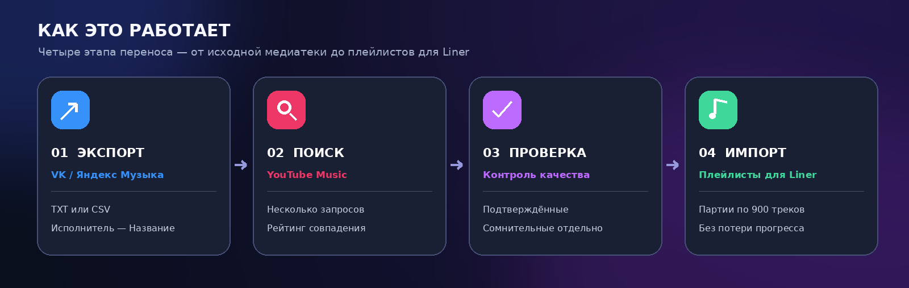

<div align="center">


# 🎶 Liner Importer — VK & Yandex Music

**Перенос музыкальных плейлистов из VK и Яндекс Музыки в YouTube Music — с подготовкой для Liner.**

[](https://www.python.org/)


**Поиск с оценкой совпадений · Плейлисты по 900 треков · Ручная проверка · Сохранение прогресса**

[Быстрый старт](#-быстрый-старт) · [Экспорт из VK](#-1-экспорт-из-vk) · [Экспорт из Яндекс Музыки](#-2-экспорт-из-яндекс-музыки) · [Авторизация YouTube](#-3-вход-в-youtube-music) · [Liner](#-5-режим-для-liner) · [FAQ](#-частые-проблемы)

</div>

---

> [!IMPORTANT]
> Это **неофициальный независимый проект**, не связанный с VK, Яндексом, Google, YouTube Music или Liner. Программа **не скачивает музыку**: она переносит *список исполнителей и названий*, находит похожие записи в YouTube Music и создаёт плейлисты. Совпадение конкретной песни не гарантируется.

## ✨ Возможности

| Возможность | Что делает |
|---|---|
| 📤 Экспорт из VK | JavaScript для консоли **`m.vk.ru`**, сохраняет TXT со списками песен |
| 📤 Экспорт из Яндекс Музыки | Python, экспорт «Мне нравится» и своих плейлистов в CSV по метаданным |
| 🔎 Умный поиск | Несколько запросов, нормализация названий, поиск в Songs / Videos / без фильтра |
| 🎧 Контроль качества | Уверенные совпадения — отдельно; спорные варианты — на проверку |
| 📂 Импорт в YouTube Music | Создание плейлистов через `ytmusicapi`, без YouTube Premium |
| 📦 Режим Liner | Части по **900 песен** (с запасом до наблюдаемого лимита 1 000) |
| 🧪 «На проверку» | Отдельный плейлист с лучшими сомнительными кандидатами; удалённое вручную не возвращается при повторном запуске |
| 💾 Надёжность | SQLite, отчёты CSV и возможность продолжать после остановки |





## 🚀 Быстрый старт

**Требования:** Windows 10/11, Python **3.11+**, интернет, Google-аккаунт. YouTube Premium не нужен. Программа использует неофициальные API, поэтому их изменения могут потребовать обновления кода.

1. Скачайте ZIP репозитория через **Code → Download ZIP**, распакуйте в папку без вложенного архива.
2. Запустите **`START_WINDOWS.bat`** → пункт **1**, чтобы установить зависимости.
3. Получите CSV: **VK — шаг 1**, **Яндекс Музыка — шаг 2** ниже; можно начать с `examples/example_playlist.txt`.
4. В меню **9** выберите CSV. В папке `data/` программа найдёт подготовленные файлы.
5. В меню **2** подключите YouTube Music и проверьте пункты **3** и **13**.
6. Пункт **4**: пробный поиск 20 песен → **5**: поиск остальных → **6**: проверка спорных.
7. Пункт **14**: создайте части для Liner, пункт **15**: отдельный список сомнительных кандидатов.

**Или через консоль:**

```powershell
python -m pip install -r requirements.txt
python prepare.py examples/example_playlist.txt
python app.py auth clipboard
python app.py auth check
python app.py auth write-test
python app.py scan data/00_all_unique.csv --limit 20
python app.py scan data/00_all_unique.csv
python app.py review data/00_all_unique.csv
python app.py liner data/00_all_unique.csv --dry-run
python app.py liner data/00_all_unique.csv --name "Моя музыка"
python app.py uncertain data/00_all_unique.csv --name "Моя музыка"
```

> [!WARNING]
> Если вы впервые запускаете пример, **не переносите демонстрационные песни вместо своих**. Выберите настоящий файл через пункт 9. Команды `liner` и `uncertain` **изменяют плейлисты YouTube Music**; `--dry-run` позволяет предварительно посмотреть план.

## 📲 1. Экспорт из VK

**Без VK API-токена.** Используем ранее разработанный браузерный экспортёр [**`exporters/vk_mobile.js`**](exporters/vk_mobile.js).

1. На ПК откройте **https://m.vk.ru/** в браузере и войдите в свой аккаунт.
2. Скопируйте ссылки на нужные плейлисты из VK. Поддерживаются обычные ссылки `vk.ru/music?z=audio_playlist...` или ссылки вида `vk.ru/music/playlist/...` (при приватном доступе нужен полный адрес с access hash).
3. Нажмите **F12 → Console (Консоль)**. Скопируйте код файла `exporters/vk_mobile.js` **целиком** и вставьте его в консоль. При необходимости разрешите вставку кода в DevTools только после самостоятельной проверки исходника.
4. Во всплывающем окне вставьте ссылки на плейлисты (через пробел или с новой строки) и подтвердите.
5. Дождитесь загрузки **`VK_playlists.txt`**. Если VK меняет внутреннюю структуру или ограничивает запросы, отдельные записи могут не выгрузиться: проверьте сообщения Console и количество песен.
6. Преобразуйте TXT в CSV:

```powershell
python prepare.py "C:\Users\YOU\Downloads\VK_playlists.txt"
```

В `data/` появятся `00_all_unique.csv` и отдельный CSV для каждого раздела. Если в исходном TXT уже есть раздел **«ОБЩИЙ УНИКАЛЬНЫЙ СПИСОК»**, программа использует его вместо повторного объединения одних и тех же песен из нескольких плейлистов.

> [!NOTE]
> Браузерный код обращается **только к текущему сайту VK** (`/audio`) и создаёт локальный TXT. Не передавайте людям свои Cookie, access hash приватных списков или скачанный файл, если его содержимое не должно быть публичным. `m.vk.ru` — внутренний неофициальный интерфейс, его работа не гарантирована.

## 🎼 2. Экспорт из Яндекс Музыки

Используется неофициальная Python-библиотека [`yandex-music`](https://github.com/MarshalX/yandex-music-api). Она позволяет выгрузить метаданные треков, **не загружая аудиофайлы**.

**Первый вход (предпочтительный способ — OAuth Device Flow):**

```powershell
python exporters/yandex_music.py --auth
```

1. Программа выведет адрес и код.
2. Откройте адрес в браузере, подтвердите вход в **свой** аккаунт Яндекса.
3. Программа сохранит токен локально в `auth/yandex_token.txt` (этот файл исключён из Git).

Далее выберите, что экспортировать:

```powershell
# «Мне нравится»
python exporters/yandex_music.py --likes

# Посмотреть названия и ID своих плейлистов
python exporters/yandex_music.py --list

# Все пользовательские плейлисты
python exporters/yandex_music.py --all-playlists

# Один конкретный плейлист (подставьте kind из --list)
python exporters/yandex_music.py --playlist-id 1001
```

Выходные файлы `Yandex_*.csv` появятся в `data/`. В меню **9** выберите нужный CSV. Если у некоторых записей метаданные недоступны, рядом создаётся **`.errors.csv`** — изучите его перед импортом.

Если `--auth` не поддерживается вашей установленной версией библиотеки, обновите зависимости и обратитесь к [документации получения токена](https://github.com/MarshalX/yandex-music-api/blob/main/docs/source/token.md). Токен можно положить в **локальный** `.env` как `YANDEX_MUSIC_TOKEN=...`; не добавляйте его в репозиторий. Учтите, что доступ к личной медиатеке зависит от условий сервиса и аккаунта.

## 🔐 3. Вход в YouTube Music

Для создания плейлистов нужна **авторизованная сессия**, а не обычный API-ключ. Основной путь — Firefox и [браузерная авторизация `ytmusicapi`](https://ytmusicapi.readthedocs.io/en/stable/setup/browser.html).

1. В Firefox откройте **https://music.youtube.com/** и войдите в Google.
2. Нажмите **F12 → Сеть / Network → XHR**.
3. Откройте Библиотеку или обновите страницу. Найдите **`POST browse?...`**, статус **200**, домен `music.youtube.com`.
4. ПКМ по **строке запроса** → **Copy → Copy Request Headers / Копировать заголовки запроса**. **Не** копируйте Payload, Preview, Response или всю страницу.
5. Откройте `START_WINDOWS.bat` → пункт **2** → Enter. Буфер прочитается автоматически, в CMD ничего вставлять не нужно.
6. Пункт **3** проверяет чтение; **13** отдельно проверяет возможность **создавать и удалять** тестовый плейлист. **Только после успешного пункта 13 начинайте запись.**

> [!CAUTION]
> **Cookie / Authorization / файлы `auth/` — секреты вашей Google-сессии.** Никому их не пересылайте, не прикладывайте к Issue и не коммитьте в публичный GitHub. Если всё-таки опубликовали — отзовите сессию и смените доступные данные авторизации.

**Резервный вариант — Google OAuth:** поддерживается `app.py auth oauth` с `YTM_CLIENT_ID`, `YTM_CLIENT_SECRET` и `YTM_AUTH_MODE=oauth` в локальном `.env`. Нужен OAuth-клиент [по документации `ytmusicapi`](https://ytmusicapi.readthedocs.io/en/latest/setup/oauth.html). Если Google Cloud ограничивает создание проекта или требует биллинг, **не нужно платить** ради импорта — сначала попробуйте Firefox.

## 🔍 4. Поиск и проверка

```powershell
python app.py scan data/00_all_unique.csv --limit 20
python app.py scan data/00_all_unique.csv
python app.py review data/00_all_unique.csv
python app.py status data/00_all_unique.csv
```

- **MATCHED** — высокая уверенность в совпадении.
- **REVIEW** — нужно подтверждение человека.
- **MISSING** — подходящая композиция не найдена.
- **PENDING** — ещё не искали.
- **UPLOADED** — добавлена в обычный плейлист.

Алгоритм **не считает все найденные результаты правильными**. Для редких VK-релизов, `speed up`, `nightcore`, каверов, акустики и мемных записей может понадобиться ручная проверка. В `work/` — состояние SQLite; в `reports/` — CSV-отчёты. Они остаются на диске между запусками и не входят в Git.

## 📦 5. Режим для Liner

По наблюдению пользователей, Liner может не принимать списки больше **1 000** композиций за один импорт. Поэтому здесь **900** по умолчанию — это запас, а не обещание официального лимита.

```powershell
python app.py liner data/00_all_unique.csv --name "My Music" --dry-run
python app.py liner data/00_all_unique.csv --name "My Music"
```

Программа использует подтверждённые совпадения и создаёт **отдельные плейлисты с доступом по ссылке (`UNLISTED`)**, не трогая большой исходный плейлист. Например, 1 303 подтверждённых трека → 900 + 403. Текущая реализация рассчитана на **не более двух частей** и останавливается, если подтверждённых песен больше вместимости выбранных частей.

Затем откройте ссылки на созданные списки и импортируйте их **в Liner по очереди**. Совместимость с конкретной версией Liner проверяется вручную.

### Отдельный плейлист сомнительных записей

```powershell
python app.py uncertain data/00_all_unique.csv --name "My Music" --dry-run
python app.py uncertain data/00_all_unique.csv --name "My Music"
```

Плейлист **«На проверку»** содержит лучшие *кандидаты* для REVIEW/MISSING с известным YouTube `videoId`. Он нужен, чтобы прослушать и вручную удалить неправильные треки. Если песня была удалена в YouTube, повторный запуск этого режима её **не добавит снова**. Композиции без каких-либо кандидатов остаются только в CSV. Не путайте этот список с уже подтверждёнными частями.

## 🗂️ Структура проекта

```text
.
├── START_WINDOWS.bat           # Русское консольное меню
├── menu.py                     # Пункты 1–17
├── app.py                      # Поиск, подтверждение, импорт и отчёты
├── matcher.py                  # Оценка совпадений
├── database.py                 # Локальное сохранение прогресса
├── auth_clipboard.py           # Вход YouTube Music через браузер
├── prepare.py                  # TXT VK → CSV
├── exporters/
│   ├── vk_mobile.js            # Экспорт с m.vk.ru (F12 → Console)
│   └── yandex_music.py         # Экспорт из Яндекс Музыки
├── examples/                   # Файлы с демонстрационными треками
├── tests/                      # Локальные тесты
├── .env.example                # Пример переменных окружения
├── data/                       # Ваши CSV/TXT — в .gitignore
├── auth/                       # СЕКРЕТЫ — в .gitignore
├── work/                       # SQLite и результаты — в .gitignore
└── reports/                    # Отчёты — в .gitignore
```

## ❓ Частые проблемы

<details><summary><b>Пункт 3 проходит, но запись выдаёт HTTP 401</b></summary>

Проверка чтения не доказывает возможность изменения плейлистов. Заново скопируйте Request Headers корректного `POST browse`, убедитесь, что это нужный Google-аккаунт, затем отдельно проверьте пункт **13**.
</details>

<details><summary><b>Код из Firefox не распознаётся</b></summary>

Копируйте **Request Headers**, а не `cURL (Windows)` или тело запроса. Буфер обмена программа читает сама.
</details>

<details><summary><b>Всё помечено «не найдено»</b></summary>

Сначала проверьте пункт **12**: поиск тестовой известной композиции. Импортёр использует английскую локаль ответа API и резервный поиск **без фильтра**, не меняя написания кириллических треков.
</details>

<details><summary><b>Программа не читает только что созданный пустой плейлист</b></summary>

У `ytmusicapi` иногда меняется структура ответа для пустых списков. Импортёр повторно использует сохранённый ID и не отправляет неоднозначные партии дважды без сверки. Если просит ручное подтверждение пустоты, проверьте URL через браузер.
</details>

<details><summary><b>Название плейлиста не изменилось после повторного запуска</b></summary>

Когда ID плейлиста уже сохранён в `work/`, новый `--name` не переименовывает существующую запись: это предохраняет от случайного создания копии. Переименуйте плейлист вручную в YouTube Music.
</details>

<details><summary><b>Можно ли загрузить готовый TXT другого сервиса?</b></summary>

Да. Используйте `python prepare.py your_playlist.txt`, если каждая строка имеет вид `Исполнитель — Название`. Неоднозначные строки помечаются для проверки.
</details>

## 🧪 Тестирование

```powershell
python -m unittest discover -s tests -v
node --check exporters/vk_mobile.js  # если установлен Node.js
```

Тесты запускаются **локально на имитациях ответов**. Реальные аккаунты, приватные плейлисты и живые API в тестах не используются.

## 🔒 Приватность и ограничения

- Никаких логинов и паролей VK, Яндекса или Google в репозитории нет.
- `auth/`, `work/`, `data/`, `reports/`, `.env` добавлены в `.gitignore`.
- Никаких аудиофайлов программа не скачивает; хранятся только метаданные и ссылки.
- VK, Яндекс Музыка, YouTube Music и Liner могут менять свои API, квоты, доступность каталога или условия использования.
- При использовании музыки и сторонних сервисов соблюдайте их условия и применимые авторские права.

**Лицензия:** [MIT](LICENSE). Приветствуются баг-репорты и pull request без Cookie, токенов и приватных плейлистов.